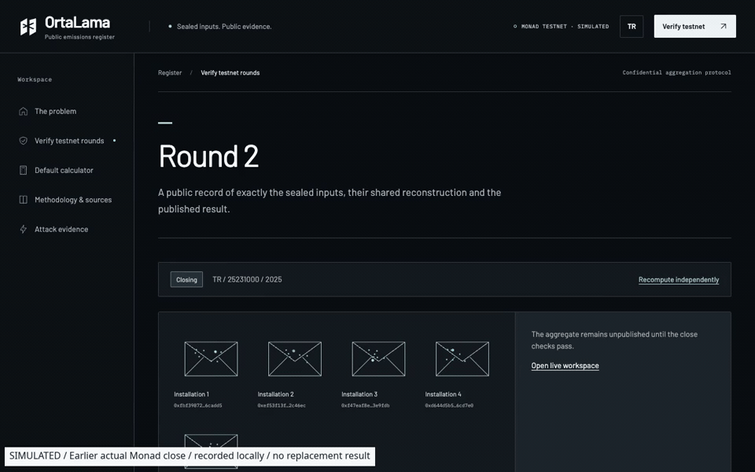
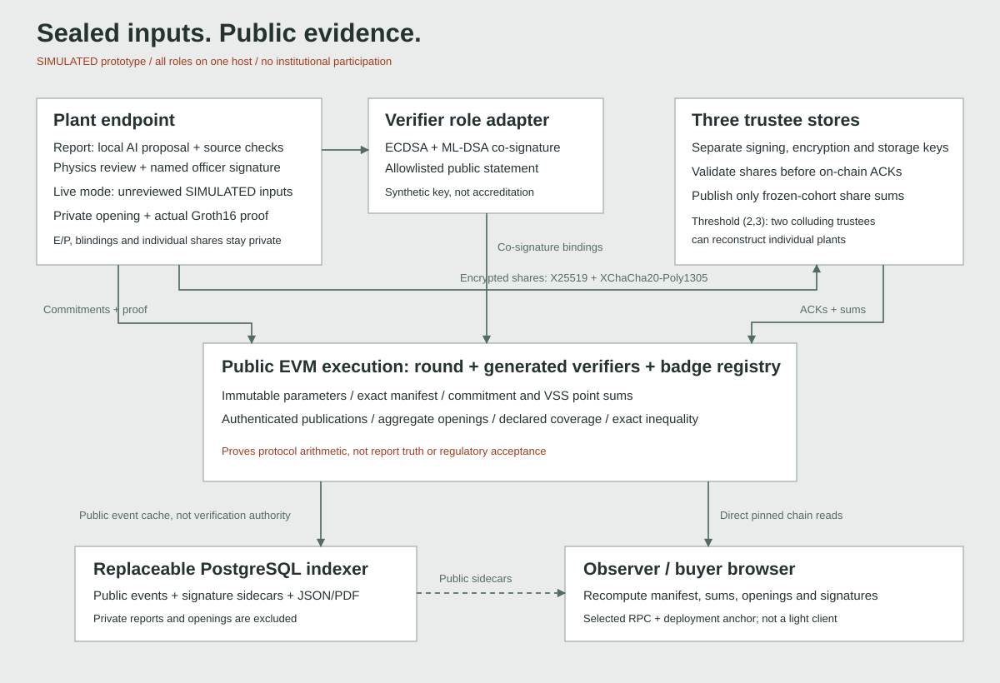

# Ortalama

**Keep plant inputs private. Make the sector's weighted emissions average checkable.**

For Türkiye grey clinker, the EU annex lists **1.551 tCO2e/t including the 2026
mark-up**, while TURKCIMENTO reports **0.88 tCO2/t from member declarations**.
Their accounting-boundary comparability is **UNVERIFIED**. The association's
historical approximately **€20/€80 per tonne** contrast is an attributed estimate,
not current liability computed by this project.
[EU annex](https://eur-lex.europa.eu/eli/reg_impl/2025/2621/oj/eng) ·
[association statement](https://www.eqs-news.com/news/media/turkcimento-calls-for-eu-aligned-mrv-data-recognition-under-cbam/347f954a-8081-4308-b01a-445e526ef6da_en).



20 seconds from the actual Monad close and a recheck of earlier mined attack
receipts. Clips are edited and labelled; no new transaction is implied by the
receipt recheck. [3:50 narrated walkthrough](docs/media/SIMULATED_monad_walkthrough_3m50s.mp4) ·
[subtitles](docs/media/SIMULATED_monad_walkthrough_3m50s.srt) ·
[recording provenance](docs/media/SIMULATED_monad_walkthrough_recording.json).

**Actual Monad testnet. SIMULATED plant inputs and identities.** Two five-plant
rounds closed at **0.848636 kg CO₂/kg product**; all six required attacks mined as
reverted, and a qualifying badge issued. All four contract sources match exactly.
[Verified round contract](https://repo.sourcify.dev/10143/0x9ea9702324c53dcfb3c179acfed122dbf52f9cfc) ·
[Actual testnet results](docs/SIMULATED_MONAD_ROUND_RESULTS.json).

**Verify a live testnet round from your phone:**
**[ortalama.onrender.com/verify/2](https://ortalama.onrender.com/verify/2)**. The page
fetches Monad testnet state and recomputes the aggregate in your browser; the
read-only site is built from source plus the committed
[public snapshot](deploy/public-snapshot) ([hosting guide](docs/HOSTING_GUIDE.md)).
Matching evidence dossier:
[JSON](deploy/public-snapshot/api/rounds/2/dossier.json) /
[PDF](deploy/public-snapshot/api/rounds/2/dossier.pdf).

- **What the chain proves:** the published aggregate opens the exact frozen set
  of signed commitments; issued badges satisfy their configured threshold proof.
- **What it cannot prove:** physical report truth, accreditation, complete population
  coverage, statistical representativeness or regulatory acceptance.
- **Why AI runs at the edge:** it proposes cited fields before sealing; source
  grounding, deterministic checks and a named signed review authorise acceptance.
  Scripted test signatures are explicitly marked automated.

Two colluding trustees can reconstruct plants. Aggregate subtraction and repeated
cohorts leak information. Current roles share one host and use simulated identities with separately generated private keys.
[Threat model](docs/THREAT_MODEL.md) · [Limits](docs/LIMITATIONS.md).

## Run locally

```sh
make demo
```

Host prerequisites: Node.js 24+, npm 11+, Python 3.11+, Make, Git and PostgreSQL
server binaries. Docker with a running Compose-capable engine is an alternative
startup path; container validation is tracked separately. The bootstrap uses
project-local pinned tools, public proving parameters and a local model. First
downloads include an approximately 986 MB model bundle. No LLM API key is needed.

Follow the printed URL and wait for the seeded scenario's checks to finish.
The runner starts its own local model, chain, isolated database, three trustee
processes, indexer, report agent and built web app. It seeds real proofs and
transactions, including six actual reverting attacks. `Ctrl-C` stops only that
invocation's processes. Private files remain under ignored `.runtime/`.
[Startup and recovery details](docs/LOCAL_DEMO.md).

Open `/live` for five private participant links, `/plant` for Turkish report review,
`/attack` for fresh failures and `/verify/:id` to fetch and recompute chain evidence.
A qualifying plant can issue an **at or below the participating cohort average** non-transferable attestation
record. No token, marketplace or NFT is implemented. Turkish/English switching,
keyboard paths and mobile verification are included; Turkish text needs native
review. Loopback URLs require this machine and are not public phone links.

## What runs

| Gate | Measured local evidence |
| --- | --- |
| Independent crypto reference | 224 TS/Python vectors, 672 trustee-pair reconstructions per language, 16 bidirectional encryption cases |
| Real Groth16 circuits | 3,742 / 7,521 constraints; seven positive and 27 negative circuit cases; Node and Chrome proofs |
| Contracts | 28 test groups; 31 custom errors triggered; fuzz, invariant and Python FFI checks; 98.276% line coverage |
| Services | Actual 12-plant close, encrypted trustee storage, PostgreSQL reorg recovery, outage/recovery and six mined attacks |
| Report agent | 20 actual local-model calls; 189/200 numeric fields and 79/200 original citations correct; all 8 planted impossible cases blocked before a signed override (physics overrides require written officer approval) |
| Browser | Five separate participant contexts; three lost-response recoveries; independent recomputation, qualifying badge, rejected above-average witness; no private fields in public requests |
| Accessibility/performance | 56 EN/TR desktop/mobile WCAG checks; local mobile Lighthouse observations 98/99 performance and 100 accessibility |
| Portable evidence | Matching Monad JSON/PDF with pinned-RPC reproduction; local dossier gate also covers 14 tamper/privacy/anchor rejections |
| Monad deployment | Two actual five-plant closes, six mined rejections, real badge, four exact source matches and independent desktop/mobile browser recomputation |

These are scoped observations, not general model accuracy or physical-phone
measurements. The AI evaluation includes disclosed repairs and a false block on a
valid report; [AI_CARD.md](docs/AI_CARD.md) gives full denominators and failures.
Accepted static findings, dependency advisories and setup limitations are disclosed,
not described as an audit-clean production system.

Run the completed layers with `make test`, `make test-agent`, `make e2e-cli`, and
the browser/dossier commands in their gate records. Current status and pending
work are in [BUILD_STATUS.md](docs/BUILD_STATUS.md). Remote gates run in
[GitHub Actions](https://github.com/rahulgunwanistudy-2005/OrtaLama/actions).

## Fresh functional re-audit

The latest re-audit also exercised five actual report-editor browsers from PDF
upload and model extraction through source corrections, signed test reviews,
commitments, fifteen encrypted deliveries, closure and independent verification.
The populated report screens passed eight additional EN/TR desktop/mobile checks.
A real chain reorganization now preserves revalidated signature sidecars for
surviving commitments and removes orphaned evidence. See
[the fix list and gate scope](docs/FUNCTIONAL_REAUDIT.md),
[report-browser evidence](docs/SIMULATED_REPORT_BROWSER_RESULTS.json) and
[indexer recovery](docs/SIMULATED_INDEXER_RECOVERY_RESULTS.json).

## Mechanism and trust



Plants use Baby Jubjub Pedersen commitments and bounded input proofs, then split
openings into encrypted (2,3) shares with blinded VSS slope commitments. Trustees
acknowledge the exact common cohort and publish aggregate shares. The contract
checks publications, reconstructs aggregate openings and verifies them against
every stored commitment. A separate authenticated transaction records a bad
trustee's fault; a revert alone cannot persist blame or abort.

The browser checks the selected chain, deployment code hashes, pinned state,
ordered manifest, curve/VSS sums, aggregate openings, result and every allowlisted
ECDSA/ML-DSA co-signature. It trusts the selected frontend/build, deployment anchor
and RPC; it is not a light client. ML-DSA is checked off-chain, and archived X25519
ciphertexts remain a future-decryption risk. The whole system is not post-quantum
secure. The circuit-specific project contribution and application curve code have
no independent production audit.

Generic country/product/year round parameters do not make cement physics
applicable to every sector. The report-sealing adapter checks supported fixture
provenance and matching round context. A reconciled programme input is still
required before official use.

## Evidence and adoption

[BIBLE](docs/BIBLE.md) · [CRYPTO_SPEC](docs/CRYPTO_SPEC.md) ·
[SOURCES](docs/SOURCES.md) · [DOSSIER](docs/DOSSIER.md) ·
[ORACLE](docs/ORACLE.md) · [THREAT_MODEL](docs/THREAT_MODEL.md) ·
[DO_YOU_NEED_A_BLOCKCHAIN](docs/DO_YOU_NEED_A_BLOCKCHAIN.md) ·
[REGULATORY_MAP](docs/REGULATORY_MAP.md) ·
[STANDARDS_CONFORMANCE](docs/STANDARDS_CONFORMANCE.md) ·
[PILOT_PLAN](docs/PILOT_PLAN.md) · [FOOTPRINT](docs/FOOTPRINT.md) ·
[Exporter brief EN](docs/EXPORTER_BRIEF_EN.md) / [TR](docs/EXPORTER_BRIEF_TR.md).

CBAM Annex IV point **7** is a possible legal evidence route, not automatic
acceptance. A voluntary cohort does not replace the TR-ETS population,
sub-installation definitions or allocation procedure. No regulator, chamber,
association, university or standards body participates in or endorses this build.
The proposed pilot is not launched, funded or scheduled. Changes in defaults or
fees are not measured physical emissions reductions.

Repository code is GPL-3.0; bundled primitives, tools, fonts and the installed
design skill retain their own licences. Public proving keys are parameters,
never signing keys or ceremony entropy. See their [provenance](circuits/ceremony/README.md).
